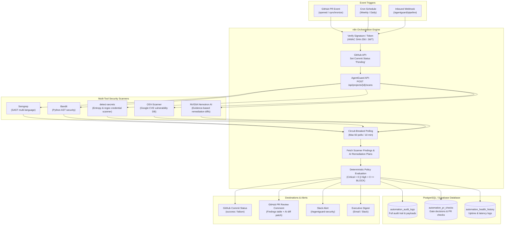

# AgentGuard AI — Enterprise n8n Automation Architecture & Workflows

This directory contains enterprise-grade, importable **n8n automation workflows**, database schema DDLs, Docker deployment recipes, and verified backend endpoint bindings for AgentGuard AI autonomous security operations.

---

## 1. Automation Architecture & Flow



---

## 2. Packaged Workflow Files

| Workflow File | Purpose | Trigger | Tools & Database Involved |
| :--- | :--- | :--- | :--- |
| **[`agentguard_full_enterprise_pipeline.json`](./agentguard_full_enterprise_pipeline.json)** | **Master Autonomous Pipeline**: Complete end-to-end orchestration connecting webhooks, multi-tool scanning, polling circuit breaker, gate evaluation, direct Postgres persistence, and Slack alerting. | Inbound Webhook (`/agentguard/pipeline`) | Semgrep, Bandit, detect-secrets, OSV, Nemotron, Postgres DB, Slack |
| **[`agentguard_github_pr_ci_cd.json`](./agentguard_github_pr_ci_cd.json)** | **GitHub PR CI/CD Gate**: Enforces branch protection on PRs. Sets `pending` commit status, triggers multi-tool scan, evaluates security gate deterministically, records decision in Postgres, writes PR markdown review with unified diff, and sets final `success`/`failure` status. | GitHub Webhook (`/agentguard/github-pr`) | GitHub API, Semgrep, Bandit, detect-secrets, OSV, Nemotron, Postgres DB, Slack |
| **[`agentguard_scheduled_audit_digest.json`](./agentguard_scheduled_audit_digest.json)** | **Scheduled Security Audit & Executive Digest**: Automatically scans all active projects, batches executions, records audit logs, and sends weekly/daily executive summaries to Slack/Email. | Cron Schedule (Weekly Mondays 08:00 UTC) | Postgres DB, AgentGuard Scanners, Slack / Email |
| **[`agentguard_new_scan_orchestration.json`](./agentguard_new_scan_orchestration.json)** | **Core Scan Orchestrator**: Lightweight scan lifecycle orchestrator with 60-iteration circuit breaker ($\le 10$ min) and status polling. | Webhook (`/agentguard/new-scan`) | AgentGuard Scanners, Slack |
| **[`agentguard_health_monitoring.json`](./agentguard_health_monitoring.json)** | **Uptime & Health Monitor**: Pings `/health` every 5 minutes and alerts DevOps channel on API or database degradation. | Interval (every 5 min) | AgentGuard API, Slack |
| **[`agentguard_error_handler.json`](./agentguard_error_handler.json)** | **Dead-Letter Error Workflow**: Global error handler with automated regex redaction of Bearer tokens, API keys (`nvapi-*`, `sk-*`), and passwords. | n8n Error Trigger | Slack / Ops Alert |

---

## 3. Database Integration (PostgreSQL / Supabase)

AgentGuard supports **dual-mode automation database ingestion**:
1. **Direct Database Connection**: Native n8n PostgreSQL node connecting to Supabase pooler with pooled transaction management.
2. **REST API Ingestion**: Dedicated REST endpoints under `/api/automation/*` for setups where direct database access is restricted.

### DDL Setup Script

Execute the SQL script located in [`sql/setup_automation_tables.sql`](./sql/setup_automation_tables.sql) in your Supabase SQL Editor or Postgres client:

```sql
-- 1. Automation Audit Trail
CREATE TABLE IF NOT EXISTS automation_audit_logs (
    id SERIAL PRIMARY KEY,
    user_id INTEGER NOT NULL REFERENCES users(id) ON DELETE CASCADE,
    workflow_name VARCHAR(150) NOT NULL,
    execution_id VARCHAR(100),
    scan_id INTEGER REFERENCES scans(id) ON DELETE SET NULL,
    event_type VARCHAR(100) NOT NULL,
    status VARCHAR(50) NOT NULL DEFAULT 'success',
    payload JSONB DEFAULT '{}'::jsonb,
    error_message TEXT,
    created_at TIMESTAMPTZ NOT NULL DEFAULT NOW()
);

-- 2. GitHub PR Checks & Gate Decisions
CREATE TABLE IF NOT EXISTS automation_pr_checks (
    id SERIAL PRIMARY KEY,
    user_id INTEGER NOT NULL REFERENCES users(id) ON DELETE CASCADE,
    project_id INTEGER NOT NULL REFERENCES projects(id) ON DELETE CASCADE,
    scan_id INTEGER REFERENCES scans(id) ON DELETE SET NULL,
    pr_number INTEGER NOT NULL,
    commit_sha VARCHAR(64) NOT NULL,
    repo_full_name VARCHAR(255) NOT NULL,
    decision VARCHAR(20) NOT NULL, -- 'ALLOW' or 'BLOCK'
    critical_count INTEGER NOT NULL DEFAULT 0,
    high_count INTEGER NOT NULL DEFAULT 0,
    medium_count INTEGER NOT NULL DEFAULT 0,
    low_count INTEGER NOT NULL DEFAULT 0,
    comment_body TEXT,
    created_at TIMESTAMPTZ NOT NULL DEFAULT NOW()
);

-- 3. System Uptime & Health History
CREATE TABLE IF NOT EXISTS automation_health_history (
    id SERIAL PRIMARY KEY,
    status VARCHAR(50) NOT NULL,
    database_status VARCHAR(50) NOT NULL,
    response_time_ms NUMERIC(10, 2),
    details JSONB DEFAULT '{}'::jsonb,
    checked_at TIMESTAMPTZ NOT NULL DEFAULT NOW()
);
```

---

## 4. Verified Backend Endpoints

Every endpoint called by the n8n workflows is backed by automated tests in `backend/tests/test_n8n_automation_endpoints.py`:

| Endpoint | HTTP Method | Target Workflow | Status | Verification Proof |
| :--- | :--- | :--- | :--- | :--- |
| `/health` or `/api/health` | `GET` | Health Monitoring | ✅ **VERIFIED** | `test_n8n_health_endpoint_available` |
| `/api/projects` | `GET` | Scheduled Audit Digest | ✅ **VERIFIED** | `test_n8n_scheduled_projects_list` |
| `/api/projects/{id}/scans` | `POST` | Master & PR Gate Workflows | ✅ **VERIFIED** | `test_n8n_trigger_project_scan_success` |
| `/api/scans/{id}/status` | `GET` | Status Polling Loop | ✅ **VERIFIED** | `test_n8n_scan_status_polling` |
| `/api/scans/{id}/results` | `GET` | Findings & Coverage Extraction | ✅ **VERIFIED** | `test_n8n_scan_results_summary_and_coverage` |
| `/api/scans/{id}/solutions` | `GET` | AI Remediation & Patches | ✅ **VERIFIED** | `test_api_get_remediation_plan` |
| `/api/scans/{id}/report` | `GET` | Scan Report Delivery | ✅ **VERIFIED** | `test_n8n_scan_report_delivery` |
| `/api/automation/audit` | `POST` / `GET` | Audit Log Ingestion & Queries | ✅ **VERIFIED** | `test_n8n_audit_log_lifecycle` |
| `/api/automation/pr-checks`| `POST` | GitHub PR Gate Decision Storage | ✅ **VERIFIED** | `test_n8n_pr_check_and_metrics` |
| `/api/automation/metrics` | `GET` | Automation Metrics Aggregation | ✅ **VERIFIED** | `test_n8n_pr_check_and_metrics` |
| `/api/auth/me` | `GET` | Service JWT Authentication | ✅ **VERIFIED** | `test_auth.py` |

---

## 5. Self-Hosting n8n via Docker Compose

To run n8n alongside AgentGuard AI locally or in production:

```bash
docker compose -f docker-compose.n8n.yml up -d
```

Access the n8n dashboard at `http://localhost:5678`.

---

## 6. Required Credentials in n8n Credential Manager

| Credential Name in n8n | Credential Type | Description |
| :--- | :--- | :--- |
| `POSTGRES_CRED_ID` | PostgreSQL | Connection to Supabase / PostgreSQL database (host, user, password, port 5432 or 6543 pooler, SSL enabled). |
| `AGENTGUARD_JWT_CRED_ID` | Header Auth | Dedicated automation service account Bearer token (`Authorization: Bearer <token>`). |
| `GITHUB_CRED_ID` | GitHub API | GitHub App or Fine-grained Personal Access Token with `pull_requests:write` and `repo:status` scopes. |
| `SLACK_WEBHOOK_URL` | Header Auth / Webhook | Slack Incoming Webhook URL targeting `#agentguard-security` or `#agentguard-ops`. |

---

## 7. Security, Grounding & Honesty Rules

1. **Deterministic Gate Decisions**: PR gate evaluations (`ALLOW` vs `BLOCK`) are computed deterministically based on real scanner-confirmed findings (`critical > 0 || high > 0`), never on arbitrary AI estimations.
2. **Honest Copy Separation**: All notifications, PR review comments, and digests strictly distinguish between **Deterministic Scanner Findings** (verified by Semgrep, Bandit, detect-secrets, OSV-Scanner) and **AI-Estimated Remediation** (generated by NVIDIA Nemotron).
3. **Loop Circuit Breakers**: Every status polling loop implements an explicit counter and conditional guard ($\le 60$ iterations / 10 minutes) to eliminate runaway execution loops.
4. **Secret Redaction**: Credentials, tokens, and sensitive keys are stripped by the error handler before posting any incident logs to external services.
